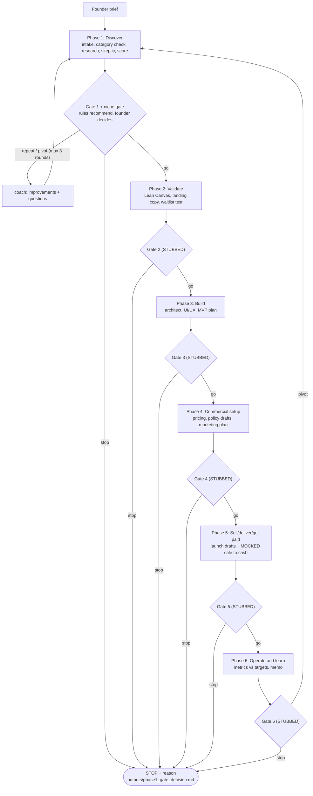
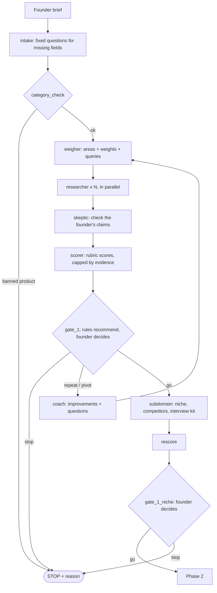
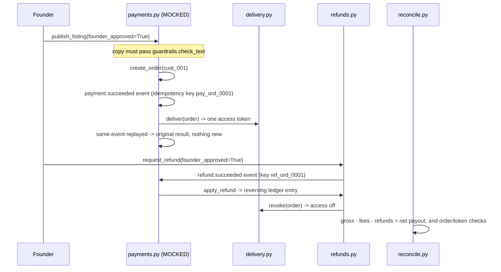
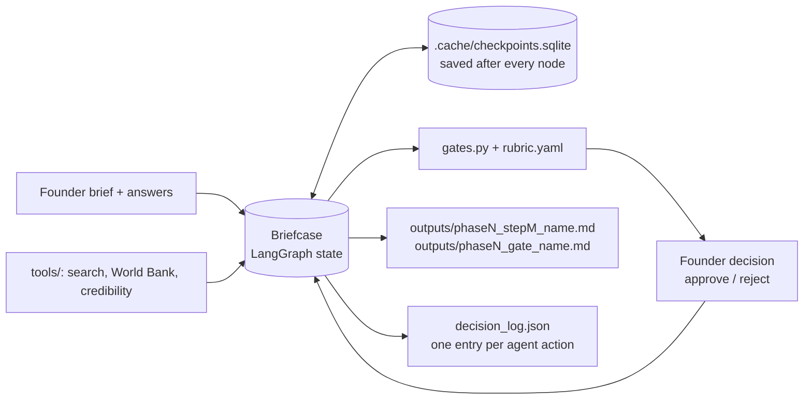

# Architecture

## Overview

Agentic Venture Builder is a team of AI agents that acts as a skeptical cofounder. It takes a founder's brief, checks the idea against rated evidence instead of believing it, and says plainly when the evidence is too weak (STOP). It then drafts the next steps toward a sellable **digital** product. Six phases run in order: Discover, Validate, Build, Commercial setup, Sell/deliver/get paid, and Operate and learn. Each phase ends at a gate. The gate's recommendation (go / repeat / pivot / stop) comes from fixed rules in plain Python ([`gates.py`](gates.py), [`rubric.yaml`](rubric.yaml)), never from the model. Nothing moves on until the founder approves or rejects it in code ([`orchestrator.py`](orchestrator.py), [`approval.py`](approval.py)). Every agent action is appended to `decision_log.json` ([`logger.py`](logger.py)), and every result is written to `outputs/`. Every claim carries a source URL with a credibility tier, a pointer to our own evidence, or the label `ASSUMPTION`. Phase 1 runs as a LangGraph graph. The Phase 2–6 agents exist as drafts and are not yet wired into the graph, so they are STUBBED. Payments are MOCKED.

## Phases

Every phase ends at a gate (see [Gates](#gates)), and every draft is shown to the founder before it is used. Core steps are marked **Core**.

### Phase 1: Discover

**Core step: find opportunities.** A LangGraph graph ([`orchestrator.py`](orchestrator.py)). One shared state, the Briefcase ([`schemas.py`](schemas.py)), is saved by a SQLite checkpointer after every node, so a gate can pause for the founder and the run can resume. A full run is budgeted at 15,000 tokens (`TOKEN_BUDGET`).

| Step | Agent / file | Method | Model? | Output |
|---|---|---|---|---|
| 1. Intake | [`agents/intake.py`](agents/intake.py) | **Fixed questions**, asked only for missing brief fields: skills, budget, time available, location, target market, team. The run pauses (`interrupt`) for the answers. The founder's answers are treated as claims to check, not facts. | No | `phase1_step1_intake.md` |
| 2. Category check | [`guardrails.py`](guardrails.py) via `orchestrator.category_check_node` | Every brief field is checked against banned categories: physical goods; financial, investment or crypto products; health advice; legal advice. A strong keyword stops the run. An ambiguous keyword (crypto, supplements, handmade, lending …) needs the fast model to confirm, and stays blocked if the model can't be reached. A banned product means STOP before any research. | Rules + fast model | `phase1_step2_category_check.md` |
| 3. Weigher | [`agents/weigher.py`](agents/weigher.py) | Splits the idea into 2–3 business areas with weights and one search query each. A "problem" area and a "competitors" area are always included. | Yes | `phase1_step3_areas.md` |
| 4. Research | [`agents/researcher.py`](agents/researcher.py) | One researcher per area, run in parallel (LangGraph `Send`). It takes the top 3 search results, usually plus one forum search (people describing the problem), rates each source A–D, and turns snippets into claims. URLs and tiers are attached in Python from the source number the model gives, so the model can't invent a URL. Anything stated without a valid source becomes `ASSUMPTION`. Country facts come from the World Bank API (tier A). | Yes | `phase1_step4_research_<area>.md` |
| 5. Skeptic | [`agents/skeptic.py`](agents/skeptic.py) | Marks up to 3 of the founder's statements as supported, contradicted or unverified. A verdict that doesn't point at a real sourced claim is demoted to unverified in Python. | Yes | `phase1_step5_skeptic.md` |
| 6. Score | [`agents/scorer.py`](agents/scorer.py) | The model proposes a 0–4 score per rubric criterion. Python caps each score by the evidence actually present (for example, market can't score above 1 without a tier A/B figure). | Yes + rules | `phase1_step6_scores.md` |
| Gate 1 | [`gates.py`](gates.py), `orchestrator.make_gate_eval/make_gate_wait` | Recommends go / repeat / pivot / stop from the rules. Pauses for the founder's decision. | No | `phase1_gate_decision.md` |
| 7. Coach | [`agents/coach.py`](agents/coach.py) | On repeat or pivot: proposes a revised idea, lists missing evidence and asks the founder questions, then loops back to the weigher. A pivot keeps the sourced problem evidence. The run stops after `MAX_ROUNDS = 3` rounds without a go. | Yes | `phase1_step7_coach.md` |
| 8. Subdomain | [`agents/subdomain.py`](agents/subdomain.py) | On go: places the idea in one precise niche (e.g. "HR tech → interview scheduling for SMEs in Egypt"), researches that niche's competitors, and re-scores. The niche gate then pauses for the founder. | Yes | `phase1_step8_niche.md`, `phase1_step8_niche_scores.md`, `phase1_gate_niche_decision.md` |
| 9. Interview kit | `agents/_common.write_interview_kit` | 5–7 Mom Test questions about past behaviour (never "would you buy this?"), for the founder to ask real people. Written after go, repeat or pivot. | Yes, with a fixed template fallback | `phase1_step9_interview_kit.md` |
| 10. Result | `orchestrator.finish_node` | Summary of the run, including the stop reason. | No | `phase1_step10_result.md` |

**Prompts:** one file per agent in [`prompts/`](prompts/). They are skeptical by design: no praise, no income promises, no invented numbers, JSON replies only.

### Phase 2: Validate

**Core step: design the business.** [`agents/phase2_lean_canvas.py`](agents/phase2_lean_canvas.py) drafts a Lean Canvas: problem, segments, unique value proposition, solution, channels, revenue, costs, key metrics and unfair advantage. It also drafts unit economics from the founder's own inputs, the riskiest assumption, and landing-page copy for a waitlist test.
- **Method:** each canvas item cites a numbered Phase 1 evidence item or becomes `ASSUMPTION`. The citation is resolved in code, so the model can't attach a source. The founder's own numbers are `ASSUMPTION`s.
- **Waitlist test:** the founder sets the target **before** the test (e.g. a number of sign-ups in 14 days) and enters the real count afterwards. The system never estimates or invents either one. The real-count step is STUBBED.
- **Output:** `phase2_step1_lean_canvas.md`.
- **Status:** the agent runs standalone and has tests ([`tests/test_phase_agents.py`](tests/test_phase_agents.py)). It is not yet wired into the graph, so it is STUBBED.

### Phase 3: Build

**Core step: build the product.** [`agents/phase3_build_plan.py`](agents/phase3_build_plan.py) drafts three proposals for the founder to approve:
- **Product architect:** stack and database, each with a reason. The database is SQLite (local) by default. A cloud free tier is used only if the founder chooses it, and the founder creates any account; the system never creates accounts or handles keys.
- **UI/UX:** the main user flows and the screens they need.
- **MVP plan:** the smallest feature set that tests the riskiest assumption. The weakest Phase 1 rubric criteria are passed in, so the MVP targets what the evidence left most uncertain. Feasibility against the founder's hours, budget and skills is labelled `ASSUMPTION`.

Output: `phase3_step1_build_plan.md`. Status: runs standalone with tests, not yet wired into the graph (STUBBED). The coder and tester agents (generate the MVP and run its tests), the docs writer, and the team builder (role description, application form, blind scoring, structured interview guide) are STUBBED.

### Phase 4: Commercial setup

**Core step: set the price and policies.** [`agents/phase4_commercial.py`](agents/phase4_commercial.py), location-aware from the founder's launch market:
- **Pricing:** a price in the local currency. Its basis is a set of claims: competitor prices (tier B), purchasing power from the World Bank (tier A), or `ASSUMPTION`. An unsourced price is called an `ASSUMPTION` for the founder to test. No payments are set up.
- **Policies:** terms, privacy and refund drafts. Each is marked "Draft, not legal advice: confirm with a lawyer or the relevant agency." They describe the seller's process. Where the founder hasn't decided something (refund windows, notice periods), the draft says `[founder to decide]` instead of inventing it.
- **Rules checklist:** registrations and regulations to check. Any item without an official (tier A) source is flagged "confirm on the official site". Dedicated rules research from official sites is STUBBED.
- **Marketing plan:** up to 3 channels, taken from where Phase 1 found the target users, with sources.
- **Questions for agencies:** email drafts with the agency's official contact, for the founder to send. STUBBED.

Output: `phase4_step1_commercial.md`. Status: runs standalone with tests, not yet wired into the graph (STUBBED).

### Phase 5: Sell/deliver/get paid

**Core steps: open the store; deliver automatically.** [`agents/phase5_launch.py`](agents/phase5_launch.py) drafts:
- the go-to-market plan: segment, positioning, channels and launch sequence;
- a store-page draft;
- up to 3 launch posts.

The price shown comes only from the Phase 4 draft. Nothing is posted or published. The founder posts each item under their own name. The store page can go live only through `payments.publish_listing(..., founder_approved=True)`, on the MOCKED store. Checkout, delivery, refunds and reconciliation are MOCKED; see [Sale to cash](#sale-to-cash). Output: `phase5_step1_launch.md`. Status: the launch agent runs standalone with tests and is not yet wired into the graph (STUBBED). Store hosting and posting are MOCKED.

### Phase 6: Operate and learn

[`agents/phase6_memo.py`](agents/phase6_memo.py) computes metrics from the sale-to-cash records: orders, paid, refunded, conversion, refund rate, gross, fees, refunds, net, and whether reconciliation matches. It compares them with the targets the founder set at Gate 2. The recommendation comes from plain Python rules:

| Condition | Recommendation |
|---|---|
| MOCKED data | repeat: fake sales can't support persevere or pivot |
| No targets set at Gate 2 | repeat: set targets first |
| Every target missed | stop |
| Some targets missed | pivot |
| Every target met | go (persevere) |

The model writes the memo text, next experiments, and two support-reply drafts. The replies are for the founder to send; the founder decides every refund, and a reply never says money was moved. There are no real customers yet, so the data is `payments.mock_sales_data()` (MOCKED), and the output says so at the top. Output: `phase6_step1_memo.md`. Status: runs standalone with tests, not yet wired into the graph (STUBBED). Sales and usage data are MOCKED.

## Gates

**The model never decides an outcome.** The scorer proposes 0–4 scores; [`gates.py`](gates.py) applies the rules in [`rubric.yaml`](rubric.yaml). The rules and weights were fixed before any run; they are our design choices, drawing on Lean Canvas and *The Mom Test*.

**Rubric (0–4 per criterion):**

| Criterion | Weight | Evidence it needs |
|---|---|---|
| Problem evidence | 20% | Several independent sources; tier D counts only as a signal |
| Market | 15% | Tier A/B numbers |
| Competition and differentiation | 15% | Competitor pages (tier B) |
| Founder and team fit | 15% | The founder's answers |
| Feasibility | 15% | The founder's answers + build estimate |
| Willingness to pay | 10% | Competitor prices, paid alternatives |
| Rules and risk | 10% | Guardrails + tier A sources |

**Order of checks at Gate 1** (`gates.evaluate_gate_1`):
1. **Guardrails.** A violation in the founder's own words (banned category, fake reviews, impersonation, income promises, money handling, accounts or passwords) → **stop**.
2. **Hard zeros.** A 0 on problem evidence, competition (0 means a free tool already solves it) or rules and risk → **stop**, whatever the total.
3. **Mostly assumptions.** 75% or more of the claims unsourced (`ASSUMPTION`), or no claims at all → **stop**.
4. **Weighted total.** **2.8 or more → go.** **Under 2.0 → stop.** In between: **pivot** if problem evidence is 3 or more (the pain is real but the idea as framed scores low), otherwise **repeat** (more evidence needed).
5. **Caps.** A go is held back to **repeat** when:
   - more than half the claims are unsourced, or
   - the Gate 1 target set in advance is missed: at least 3 independent domains showing the pain, at least 50% of claims sourced, and founder fit of 2 or more.
6. **Rewritable violations.** A guardrail hit in a draft our own agents wrote turns anything but stop into **repeat**, so the draft is rewritten.

**When the system recommends STOP:**
- a banned product (checked before any research);
- a guardrail violation in the founder's own words;
- a 0 on problem evidence, competition, or rules and risk;
- mostly `ASSUMPTION`s;
- a weighted total under 2.0;
- 3 rounds of repeat/pivot without a go.

On a deliberately weak idea, the system recommends stop (`test_weak_idea_recommends_stop` in [`tests/test_orchestrator.py`](tests/test_orchestrator.py)).

**Founder approval, enforced in code:**
- **Pause:** every gate pauses the graph (`interrupt`), and the run continues only with a `FounderDecision` for that exact gate (`orchestrator.resume_run`). Anything else raises an error and leaves the run paused.
- **Approve vs. reject:** approving keeps the recommended outcome; rejecting must name a different one (`orchestrator.check_approval`). The decision is validated by `approval.record_decision` and logged with `approved_by: "founder"`.
- **Overrides:** a founder overriding a stop is recorded as an override in the gate file and the log.
- **Before the founder answers:** the gate file says "Waiting for the founder" and nothing is logged as approved ([`tests/test_approval.py`](tests/test_approval.py)).

**Gates 2–6** use the same four outcomes against targets set before each phase. Their gate nodes are not built yet (STUBBED). The planned targets:

| Gate | Target set before the phase | Recommends stop when |
|---|---|---|
| 2 Validate | The founder sets a waitlist target in advance and enters the real count | Real count far below target; no real count yet → repeat, never invented |
| 3 Build | Smoke tests pass; user docs exist | Tests still fail after a repeat |
| 4 Commercial | Price has a stated basis; policy drafts exist; no guardrail violations | Pricing works only with income promises or dark patterns |
| 5 Launch | The founder approved each post and the store page; the mocked delivery test passes | Delivery or reconciliation mismatch |
| 6 Operate | Memo backed by the logged metrics | Metrics below the Gate 2 targets (rules in Phase 6 above) |

## Sale to cash

**MOCKED.** The whole flow runs on fake in-memory events. There is no payment provider, no API keys, no sandbox and no money. The system never holds, moves or refunds money: in real life the founder sells through their own provider account. These modules simulate the provider's events so delivery, refunds and reconciliation can be tested. Customers are pseudonyms (`cust_001`), and no names, emails or card data are stored.

1. **Payment triggers delivery.** A mock `payment.succeeded` event for an order makes [`delivery.py`](delivery.py) issue one access token. The payment must match the order's amount and currency, or nothing is delivered.
2. **Idempotency prevents double delivery.** Every event carries an idempotency key. A replayed key returns the original result and creates no second token, payment or ledger entry. `deliver()` is idempotent on its own too.
3. **A refund revokes access.** [`refunds.py`](refunds.py) needs `founder_approved=True`, because a refund moves money. The simulated refund marks the order refunded, adds a reversing ledger entry and deactivates the token. A replayed refund changes nothing.
4. **Reconciliation.** [`reconcile.py`](reconcile.py) compares our ledger with the mocked provider's payout statement, which is computed independently from the payment and refund records. It checks gross − fees − refunds = net, flagging any mismatch:
   - a payment that doesn't match its order;
   - a double sale;
   - a paid order without exactly one active token;
   - a refunded or unpaid order that still has access.
5. **Store listing.** It needs the founder's approval and copy that passes `guardrails.check_text`; for example, "Only 3 left!" is refused.

The fee is a MOCKED 3% (an `ASSUMPTION`, not any provider's pricing). The test run (12 steps, including a duplicate event, a wrong amount, a refund without approval and a payout off by 100) is written by `python payments.py` to [`outputs/payment_test_log.md`](outputs/payment_test_log.md). Tests: [`tests/test_sale_to_cash.py`](tests/test_sale_to_cash.py).

## Data flow

- **The Briefcase** ([`schemas.py`](schemas.py)) carries:
  - the brief and the founder's answers;
  - areas and weights;
  - every claim with its support;
  - claim checks, scores and score notes;
  - gate results and founder decisions;
  - guardrail hits, the round, and the token total.
  
  Lists written by parallel researchers use an "add" reducer, so they append instead of overwriting. A `Claim` must have a URL (with tier and the date read), our own evidence (`evidence_ref`: a test, eval, log or output file), or be `ASSUMPTION`; the model refuses anything else.
- **`decision_log.json`** ([`logger.py`](logger.py)): one entry per agent action, appended. Every entry has `action`, `sources` (a list of URLs), `model` (`null` for steps without AI), `cost` (USD, 0 on free models) and `approved_by` (`"founder"` for gated actions, otherwise `null`). Gate entries add `outcome`, and model calls add `tokens`.
- **`outputs/`** ([`logger.py`](logger.py)): text files named `phase<N>_step<M>_<name>.md` and `phase<N>_gate_<name>.md`. A MOCKED or STUBBED step's file starts with that label.
- **Source tiers** ([`tools/credibility.py`](tools/credibility.py)). Rules are checked in this order: official, then community, then news, then the default.

  | Tier | Kind | Examples | Can support | Weight |
  |---|---|---|---|---|
  | A | Official | `.gov` / `gov.<cc>` sites, regulators, central banks, World Bank, IMF, OECD, UN | Market size, demographics, regulation | 1.0 |
  | B | Primary | The company's or author's own site, filings, papers, app stores | Competitors, features, prices | 0.8 |
  | C | Reputable secondary | Established news outlets, research firms' public pages | Trends, context | 0.6 |
  | D | Community | Reddit, Hacker News, Facebook, X, forums, review sites | Signs of pain or demand only, never numbers | 0.3 |
  | — | No source | — | Nothing: labelled `ASSUMPTION` | 0 |

  **Rule: unknown -> B.** A domain in no list is rated B, treated as a primary source (the company's or author's own site), and the reason is stored with the rating. Market-size and regulation claims need tier A or B; the scorer caps scores accordingly.
- **Data sources (free, no keys):**
  - Web search ([`tools/search.py`](tools/search.py)) tries free engines in order: DuckDuckGo and its other `ddgs` backends, then the Wikipedia search API, then Hacker News Algolia. Results are cached under `.cache/search/`.
  - World Bank Open Data ([`tools/worldbank.py`](tools/worldbank.py)): population, internet users (%) and GDP per capita, cached under `.cache/worldbank/`. Each value is tier A and keeps its exact API URL.
  - IMF, OECD, UN, Eurostat and national statistics offices (e.g. CAPMAS) are STUBBED. Paid databases are not used.
- **Models:** [`llm.py`](llm.py) and [`config.py`](config.py). With `LLM_PROVIDER=auto`, the system uses Groq's free tier (open-weight `gpt-oss-120b` and `gpt-oss-20b`) when a key is set in the local `.env`, and local Ollama (`qwen3:8b`) otherwise. No paid service is required.
- **Guardrail eval data** ([`evals/`](evals/)):
  - trick prompts, held-out prompts and legitimate briefs;
  - the runner `run_guardrails.py`;
  - results in `evals/guardrail_results.md`, which says which checks ran.

## Built vs. stubbed

This table is copied from the README's "What works and what is mocked" table and must stay identical to it.

| Phase | Step | Status | Notes |
|---|---|---|---|
| All | Shared foundation: settings, model client, state schemas, decision log, output writer (`config.py`, `llm.py`, `schemas.py`, `logger.py`) | **Working** | `tests/test_smoke.py` |
| All | LangGraph orchestration (`orchestrator.py`) | **STUBBED** | Not built yet |
| All | Founder approve/reject at every gate (`approval.py`, `gates.py`) | **Working** | `tests/test_record_decision.py`, `tests/test_approval.py`, `tests/test_gates.py` |
| All | Guardrails (`guardrails.py`) | **Working** | `tests/test_guardrails.py`, `tests/test_guardrail_eval.py`; results in `evals/guardrail_results.md` |
| All | Data tools: web search with a fallback chain of free engines, World Bank indicators, A–D source ratings (`tools/search.py`, `tools/worldbank.py`, `tools/credibility.py`) | **Working** | `tests/test_search.py`, `tests/test_worldbank.py`, `tests/test_credibility.py` |
| Discover | Intake and follow-up questions | **STUBBED** | Not built yet |
| Discover | Business-area weighting, research with rated sources | **STUBBED** | Not built yet |
| Discover | Claim check, rubric score, Gate 1 with STOP | **STUBBED** | Not built yet |
| Validate | Lean Canvas, landing-page copy | **STUBBED** | Not built yet |
| Build | Product, UI/UX and MVP-plan proposals | **STUBBED** | Not built yet |
| Commercial setup | Pricing and draft policies | **STUBBED** | Not built yet |
| Sell/deliver/get paid | Checkout, delivery, refunds, reconciliation (`payments.py`, `delivery.py`, `refunds.py`, `reconcile.py`) | **MOCKED** | Fake in-memory events: no payment provider, no sandbox, no real money. `tests/test_sale_to_cash.py`; `outputs/payment_test_log.md` |
| Operate and learn | Metrics and persevere-or-pivot memo | **STUBBED** | Not built yet |

## Roadmap

From the plan, after the hackathon:

- **Wire Phases 2–6 into the graph,** each with its own founder gate and the targets in [Gates](#gates). Then the draft agents can move from STUBBED to Working once they run end to end with tests.
- **Gate 2 waitlist test:** the founder enters the real sign-up count, and the gate compares it with the target set in advance.
- **Build agents:** coder and tester agents that generate the MVP in a separate project folder and run its tests; a docs writer; and the team builder (role description, application form, blind scoring of exported responses, structured interview guide, suggested slots). People stay in charge of hiring.
- **Commercial setup:** rules research from official (tier A) sites only, and email drafts to agencies with their official contact details, for the founder to send.
- **More data sources:** IMF, OECD, UN, Eurostat and national statistics offices such as CAPMAS; the Wikipedia pageviews API for interest over time; a RAG store of past runs' post-mortems.
- **Operate and learn on real data:** sales and usage data from the founder's own store, in place of the MOCKED dataset.
- **Guardrails:**
  - held-out trick prompts from people who haven't seen the rules, reported separately;
  - French and Arabic rules for every guardrail, not only fake reviews, impersonation and income promises.
- **Meetings:** joining interviews as a visible note-taker, only with everyone's consent. Today the system prepares the guide and analyses the founder's notes afterwards.
