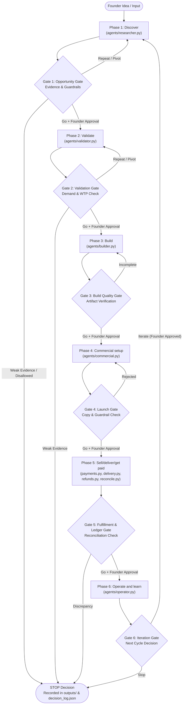
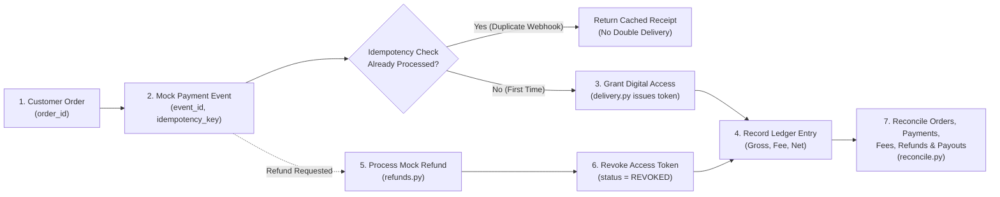
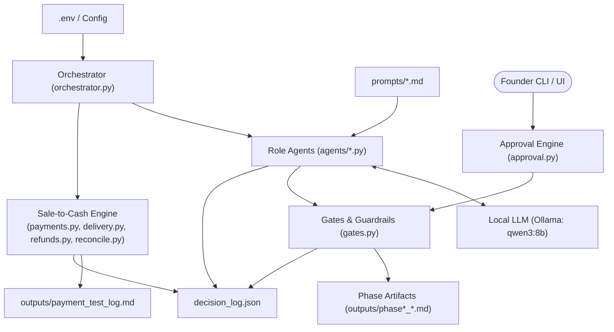

# Architecture

## Overview

Agentic Venture Builder is an open-source multi-agent pipeline that guides a founder from an initial raw concept to a validated, sellable digital product. The system executes six sequential phases (**Discover**, **Validate**, **Build**, **Commercial setup**, **Sell/deliver/get paid**, and **Operate and learn**), separated by deterministic evidence gates and mandatory founder approval checkpoints enforced in code (`gates.py` and `approval.py`). Every agent step logs its inputs, cited sources, model usage, cost, and approval state to `decision_log.json`, and writes structured text artifacts to `outputs/`.

## Phases

### Phase 1: Discover
- **Agents:** `agents/researcher.py` (prompt: `prompts/researcher.md`)
- **Tools:** Public forum/web scraping adapters, guardrail category classifier, source citation verifier.
- **Method:**
  - **Step 1.1 (Problem & Opportunity Scan):** Parses the founder's domain seed, checks that the domain does not involve prohibited categories (physical goods, financial/investment/crypto, health or legal advice), and extracts recurring user pain points. Every factual claim must carry a verifiable URL or be explicitly tagged `ASSUMPTION`.
  - **Step 1.2 (Opportunity Scoring):** Scores candidate digital product opportunities on pain frequency, urgency, and feasibility as a standalone digital download or software tool.
- **Output:** `outputs/phase1_step1_opportunities.md`, `outputs/phase1_gate_decision.md`.

### Phase 2: Validate
- **Agents:** `agents/validator.py` (prompt: `prompts/validator.md`)
- **Tools:** Competitor matrix builder, willingness-to-pay (WTP) signal analyzer, falsification checklist.
- **Method:**
  - **Step 2.1 (Demand & Alternative Analysis):** Maps existing workarounds, open-source alternatives, and commercial pricing benchmarks with cited URLs or `ASSUMPTION` tags.
  - **Step 2.2 (Validation Scorecard):** Evaluates whether target buyers already spend time or money solving the problem. If evidence consists solely of unverified assumptions or saturated free alternatives, flags the idea for a `stop` recommendation.
- **Output:** `outputs/phase2_step1_validation.md`, `outputs/phase2_gate_decision.md`.

### Phase 3: Build
- **Agents:** `agents/builder.py` (prompt: `prompts/builder.md`)
- **Tools:** Specification generator, template/code synthesizer, local package verifier.
- **Method:**
  - **Step 3.1 (Product Specification):** Defines the exact scope of the digital product (e.g., CLI utility, developer template pack, automation script bundle, or structured playbook) with zero hidden paywalls.
  - **Step 3.2 (Asset Generation & Verification):** Produces the deliverable digital artifact along with usage documentation and self-check tests.
- **Output:** `outputs/phase3_step1_product_spec.md`, `outputs/phase3_step2_artifact_manifest.json`, `outputs/phase3_gate_decision.md`.

### Phase 4: Commercial setup
- **Agents:** `agents/commercial.py` (prompt: `prompts/commercial.md`)
- **Tools:** Honest copy linter (blocks fake reviews, countdown timers, and income promises), pricing calculator, mocked checkout configurator.
- **Method:**
  - **Step 4.1 (Offer & Honest Landing Copy):** Generates product positioning, transparent pricing, refund policy, and landing page copy. Runs automated compliance checks to guarantee no fabricated testimonials, urgency timers, or income claims exist.
  - **Step 4.2 (Mock Checkout Configuration):** Prepares mock product SKU metadata and webhook endpoints awaiting founder sign-off.
- **Output:** `outputs/phase4_step1_commercial_offer.md`, `outputs/phase4_gate_decision.md`.

### Phase 5: Sell/deliver/get paid
- **Agents & Modules:** `payments.py`, `delivery.py`, `refunds.py`, `reconcile.py`
- **Tools:** Mocked payment processor, idempotent fulfillment store, access token manager, ledger reconciliation engine.
- **Method:**
  - **Step 5.1 (Checkout & Payment Capture):** Processes mocked checkout events (`MOCKED` only; never stores raw card numbers or passwords).
  - **Step 5.2 (Idempotent Delivery):** Upon verified payment event, issues a unique download/access token tied to the `order_id` and `idempotency_key`. Duplicate webhook deliveries return the existing receipt without re-sending or double-charging.
  - **Step 5.3 (Refund & Revocation):** On a mocked refund event, marks the order refunded and immediately revokes the delivery token.
  - **Step 5.4 (Ledger Reconciliation):** Reconciles orders, gross payments, processor fees, refunds, and net payouts into a balanced report.
- **Output:** `outputs/phase5_step1_reconciliation.json`, `outputs/payment_test_log.md`, `outputs/phase5_gate_decision.md`.

### Phase 6: Operate and learn
- **Agents:** `agents/operator.py` (prompt: `prompts/operator.md`)
- **Tools:** Telemetry aggregator, refund/feedback analyzer, backlog prioritizer.
- **Method:**
  - **Step 6.1 (Operations & Cohort Summary):** Analyzes mocked order conversion, delivery latency, refund reasons, and support questions.
  - **Step 6.2 (Next-Iteration Recommendation):** Synthesizes an evidence-backed recommendation on whether to ship a point update, pivot positioning, or sunset the product.
- **Output:** `outputs/phase6_step1_operations_report.md`, `outputs/phase6_gate_decision.md`.

## Gates

Every phase transition passes through `gates.py` and `approval.py`. A gate combines **automated policy & evidence checks** with **mandatory founder approval enforced in code**.

- **What each gate checks:**
  1. **Prohibited Category Guardrail:** Rejects physical goods, financial/investment/crypto products, and health or legal advice products.
  2. **Honesty & Citation Policy:** Verifies that every market claim cites a URL or is explicitly marked `ASSUMPTION`, and that commercial copy contains zero fake reviews, testimonials, sign-ups, countdown timers, or income promises.
  3. **Evidence Sufficiency Score:** Computes the ratio of sourced evidence to unverified assumptions, pain severity, and willingness-to-pay signals.
  4. **Founder Sign-Off (`approval.py`):** Blocks execution until the founder explicitly approves or rejects the gate via CLI/UI (`approved_by: "founder"` in `decision_log.json`).
- **Gate outcomes:**
  - `go`: Evidence meets threshold and founder approves advancing to the next phase.
  - `repeat`: Evidence is incomplete; re-run the current phase with refined queries.
  - `pivot`: Core pain exists but the proposed digital product framing fails validation; loop back to adjust target segment or format.
  - `stop`: Terminal halt recorded in `outputs/phase<N>_gate_decision.md` and `decision_log.json`.
- **When the system recommends `STOP` on weak evidence:**
  - More than 50% of market demand claims are untagged or rely solely on `ASSUMPTION` without corroborating public sources.
  - Zero verifiable willingness-to-pay signals are found, or existing free tools completely solve the exact problem with low switching friction.
  - The idea touches a disallowed category (physical, financial/crypto, medical, legal) or requires deceptive marketing tactics to sell.

## Sale to cash

The commercial transaction lifecycle in Phase 5 ensures deterministic links between payment, fulfillment, revocation, and accounting in mocked mode (`payments.py`, `delivery.py`, `refunds.py`, `reconcile.py`):

1. **Payment triggers delivery:** A verified `payment.succeeded` mock event automatically invokes `delivery.py` to provision a unique digital access token for `order_id`.
2. **Idempotency prevents double delivery:** Every webhook event and fulfillment call is keyed by `(order_id, idempotency_key)`. Replaying the same payment event returns the original delivery record without creating duplicate tokens or duplicate ledger credits.
3. **Refund revokes access:** Processing a refund through `refunds.py` transitions the order state to `refunded`, appends a reversing ledger entry, and immediately invalidates the customer's download/access token (`access_active = False`).
4. **Reconciliation matches orders, payments, fees, and payouts:** `reconcile.py` cross-checks every order against captured payments, processor fees, refunded amounts, and net payout totals (`gross - fees - refunds == net_payout`), flagging any mismatch or orphaned delivery.

## Data flow

All state transitions are file-backed and human-readable:
- **Inputs:** Founder idea prompt, `.env` configuration, and role instructions in `prompts/*.md`.
- **Execution trace:** Every agent action, gate evaluation, and approval step appends a JSON record (`timestamp`, `agent`, `action`, `sources`, `model`, `cost`, `approved_by`) to `decision_log.json`.
- **Phase deliverables:** Written to `outputs/phase<N>_step<M>_<short-name>.<ext>` and `outputs/phase<N>_gate_<short-name>.<ext>`.

## Built vs. stubbed

The repository is under active construction during the hackathon. This table is kept in line with the README's "What works and what is mocked" table.

| Component | File(s) | Status | Details |
|---|---|---|---|
| Shared foundation: config, model client, state schemas, decision log and output writer | `config.py`, `llm.py`, `schemas.py`, `logger.py` | **Working** | Covered by `tests/test_smoke.py` |
| Orchestration and Phase 1 agents | `orchestrator.py`, `agents/*.py`, `prompts/*.md` | **STUBBED** | Not built yet |
| Gates and founder approval | `gates.py`, `approval.py` | **STUBBED** | Not built yet |
| Sale-to-cash flow | `payments.py`, `delivery.py`, `refunds.py`, `reconcile.py` | **STUBBED** | Will be `MOCKED` only (no payment provider, no sandbox) |
| Phases 2-6 agents | `agents/*.py` | **STUBBED** | Not built yet |

## Roadmap

1. **Full Local Agent Pipeline Execution:** Connect `orchestrator.py` and all `agents/*.py` modules to local `qwen3:8b` via Ollama with structured JSON output validation.
2. **Live Public Source Connectors:** Add zero-cost read-only connectors (Hacker News Algolia API, Reddit public JSON feeds, GitHub Issues search) with automatic URL verification.
3. **Interactive Founder Gate UI:** Provide a lightweight web dashboard alongside the CLI approval prompt to inspect evidence tables, diff artifacts, and approve/reject gates.
