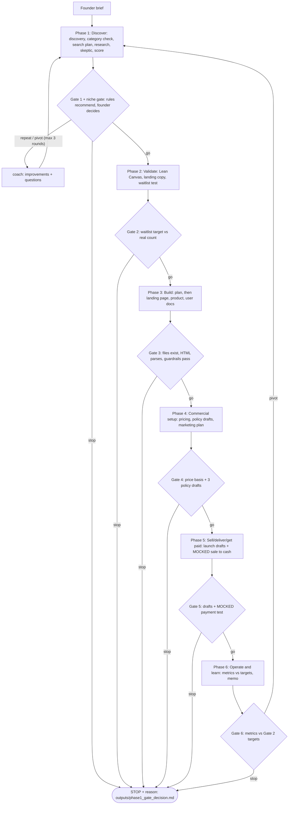
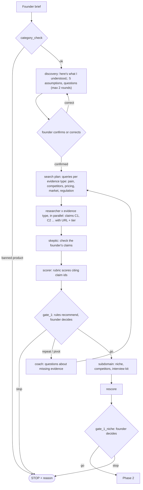
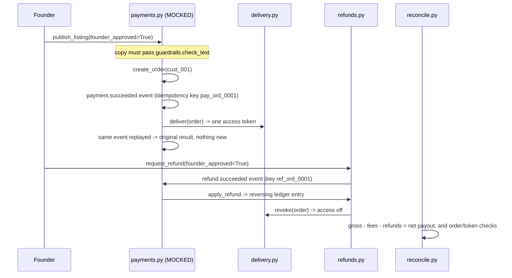
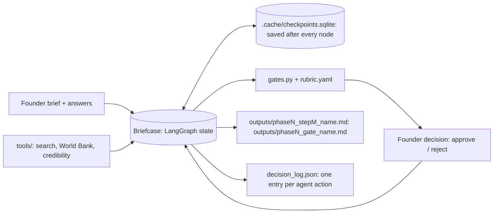

# Architecture

## Overview

Agentic Venture Builder is a team of AI agents that acts as a skeptical cofounder. It takes a founder's brief, checks the idea against rated evidence instead of believing it, and says plainly when the evidence is too weak (STOP). It then drafts the next steps toward a sellable **digital** product. Six phases run in order: Discover, Validate, Build, Commercial setup, Sell/deliver/get paid, and Operate and learn. Each phase ends at a gate. The gate's recommendation (go / repeat / pivot / stop) comes from fixed rules in plain Python ([`gates.py`](gates.py), [`rubric.yaml`](rubric.yaml)), never from the model. Nothing moves on until the founder approves or rejects it in code ([`orchestrator.py`](orchestrator.py), [`approval.py`](approval.py)). Every agent action is appended to `decision_log.json` ([`logger.py`](logger.py)), and every result is written to `outputs/`. Every claim carries a source URL with a credibility tier, a pointer to our own evidence, or the label `ASSUMPTION`. All six phases run in one LangGraph graph, each ending at its own founder gate. Discovery, research, scoring and Gate 1 run end to end; the coach and niche path remain STUBBED in the status table; the Phase 2–6 agents run in the graph but their outputs are drafts labelled STUBBED. Payments are MOCKED.

## Phases

Every phase ends at a gate (see [Gates](#gates)), and every draft is shown to the founder before it is used. Core steps are marked **Core**.

### Phase 1: Discover

**Core step: find opportunities.** A LangGraph graph ([`orchestrator.py`](orchestrator.py)). One shared state, the Briefcase ([`schemas.py`](schemas.py)), is saved by a SQLite checkpointer after every node, so a gate can pause for the founder and the run can resume. The 15,000-token `TOKEN_BUDGET` is a reporting threshold: exceeding it is logged at finish, not prevented by a hard execution cap.

| Step | Agent / file | Method | Model? | Output |
|---|---|---|---|---|
| 1. Category check | [`guardrails.py`](guardrails.py) via `orchestrator.category_check_node` | Python checks every brief field for prohibited requests before the category model runs. The category check then covers physical goods; financial, investment or crypto products; health advice; legal advice. A strong keyword stops the run. An ambiguous keyword (crypto, supplements, handmade, lending …) needs the fast model to confirm, and stays blocked if the model can't be reached. A prohibited request or banned product means STOP before research. The graph checks again after discovery. | Rules + fast model | `phase1_step1_category_check.md` |
| 1. Discovery | [`agents/discovery.py`](agents/discovery.py) | "Here's what I understood" plus five assumptions (customer, problem, current alternative, why now, payment), built in Python from the brief and the founder's answers, with the model's text used only when it adds something. Questions carry the assumption type they ask about; at most 2 rounds; then the founder confirms or corrects. Only a confirmed understanding goes to research. | Yes (fast) | `phase1_step1_discovery.md` |
| 2. Search plan | [`agents/search_plan.py`](agents/search_plan.py) | Python fills query templates per evidence type from the confirmed keywords: pain (incl. Reddit and Hacker News), competitors (incl. Google Play), pricing, market (World Bank) and regulation when the activity is regulated; Arabic keywords for Egypt; at most 12 queries, each with its reason. | No | `phase1_step2_search_plan.md` |
| 3. Research | [`agents/researcher.py`](agents/researcher.py) | One researcher per evidence type, in parallel (LangGraph `Send`). A result is kept only if a keyword-overlap score passes and the model flags it relevant; one site counts once (each forum thread once); every dropped result is logged with its reason. Each kept result becomes a claim with an id (C1 …), its type, URL and A–D tier, attached in Python so the model can't invent a URL. Country facts come from the World Bank API (tier A). | Yes (fast) | `phase1_step3_research.md` |
| 5. Skeptic | [`agents/skeptic.py`](agents/skeptic.py) | Marks up to 3 of the founder's statements as supported, contradicted or unverified. A verdict that doesn't point at a real sourced claim is demoted to unverified in Python. | Yes | `phase1_step5_skeptic.md` |
| 6. Score | [`agents/scorer.py`](agents/scorer.py) | The model proposes a 0–4 score per criterion with the claim ids it rests on. Python checks them: a score above 1 on problem, competition, willingness to pay or market without a cited claim of that type is capped at 1 ("no evidence"); market can't exceed 1 without a tier A/B figure; rules and risk comes from the guardrails; a missing criterion means "scoring incomplete -> repeat", never a 0. | Yes + rules | `phase1_step6_scores.md` |
| Gate 1 | [`gates.py`](gates.py), `orchestrator.make_gate_eval/make_gate_wait` | Recommends go / repeat / pivot / stop from the rules. Pauses for the founder's decision. | No | `phase1_gate_decision.md` |
| 7. Coach | [`agents/coach.py`](agents/coach.py) | On repeat or pivot: proposes a revised idea, lists missing evidence and asks the founder about the missing evidence types, then loops back to the search plan. An accepted pivot makes the next research round the evidence cutoff; earlier claims remain in the audit history. The run stops after `MAX_ROUNDS = 3` rounds without a go. | Yes | `phase1_step7_coach.md` |
| 8. Subdomain | [`agents/subdomain.py`](agents/subdomain.py) | On go: places the idea in one precise niche (e.g. "HR tech → interview scheduling for SMEs in Egypt"), researches that niche's competitors, and re-scores. The niche gate then pauses for the founder. | Yes | `phase1_step8_niche.md`, `phase1_step8_niche_scores.md`, `phase1_gate_niche_decision.md` |
| 9. Interview kit | `agents/_common.write_interview_kit` | 5–7 Mom Test questions about past behaviour (never "would you buy this?"), for the founder to ask real people. Written after go, repeat or pivot. | Yes, with a fixed template fallback | `phase1_step9_interview_kit.md` |
| 10. Result | `orchestrator.finish_node` | Summary of the run, including the stop reason. | No | `phase1_step10_result.md` |

**Prompts.** [`prompts/`](prompts/) contains the Phase 1 prompts and the prompts for the Phase 2–6 draft agents.

**Discovery conversation** ([`agents/discovery.py`](agents/discovery.py)). The live path uses `prompts/discovery.md`; `agents/questions.py` is present but bypassed because `_hashish()` returns `None`. Python assembles the summary and five typed assumptions from the brief, useful model text, founder answers and corrections. Founder answers take precedence over model assumptions. Empty, unclear and copied prompt text is rejected. Questions include a reason, suggestions and an assumption type; missing fields have fixed fallback questions. There are at most two question rounds, then the founder confirms or corrects the understanding. A brief already carrying all five `confirmed_understanding` fields skips discovery.

After repeat or pivot, `agents/coach.py` asks about missing evidence types and sends the next round to the search plan. The separate `agents/questions.py` tests do not demonstrate its use in the live graph.

**Search plan by evidence type** ([`agents/search_plan.py`](agents/search_plan.py), [`agents/researcher.py`](agents/researcher.py)). The confirmed keywords become queries for each evidence type: pain, competitors, pricing, market and regulation. One researcher runs per type. Every claim it keeps carries an id (C1, C2 …) and its type, so later steps can cite it.

**Evidence-cited evaluation memo** (`orchestrator.build_memo`). Every gate payload contains a memo built entirely in Python from the gate recommendation and reasons. Phase 1 also includes criterion scores, score reasoning and cited claim ids already in state. The memo lists missing citations and fixed next-step text for go, repeat, pivot or stop. It makes no model call and does not independently revalidate the scorer's claims. The serialized `source` value is currently `fallback`, although this is the live implementation. `agents/evaluation_memo.py` is available separately but is not called by the live graph.

`orchestrator._memo_markdown` renders the memo into the gate file. The committed `phase1_step5_evaluation.md` is a historical run artifact; the current memo path does not generate that separate file. It must not be presented as a newly generated output of this implementation.

### Phase 2: Validate

**Core step: design the business.** [`agents/phase2_lean_canvas.py`](agents/phase2_lean_canvas.py) drafts a Lean Canvas: problem, segments, unique value proposition, solution, channels, revenue, costs, key metrics and unfair advantage. It also drafts unit economics from the founder's own inputs, the riskiest assumption, and landing-page copy for a waitlist test.
- **Method:** each canvas item cites a numbered Phase 1 evidence item or becomes `ASSUMPTION`. The citation is resolved in code, so the model can't attach a source. The founder's own numbers are `ASSUMPTION`s.
- **Waitlist test:** the founder sets the target **before** the test (e.g. a number of sign-ups in 14 days) and enters the real count afterwards. The system never estimates or invents either one. The graph pauses for founder-entered targets and count; it does not collect or independently verify sign-ups. The landing-page form is STUBBED.
- **Output:** `phase2_step1_lean_canvas.md`.
- **Status:** the draft agent runs in the graph after the niche gate and has tests ([`tests/test_phase_agents.py`](tests/test_phase_agents.py), [`tests/test_orchestrator.py`](tests/test_orchestrator.py)). Its outputs remain STUBBED.

### Phase 3: Build

**Core step: build the product.** [`agents/phase3_build_plan.py`](agents/phase3_build_plan.py) drafts three proposals for the founder to approve:
- **Product architect:** stack and database, each with a reason. The database is SQLite (local) by default. A cloud free tier is used only if the founder chooses it, and the founder creates any account; the system never creates accounts or handles keys.
- **UI/UX:** the main user flows and the screens they need.
- **MVP plan:** the smallest feature set that tests the riskiest assumption. The weakest Phase 1 rubric criteria are passed in, so the MVP targets what the evidence left most uncertain. Feasibility against the founder's hours, budget and skills is labelled `ASSUMPTION`.

Output: `phase3_step1_build_plan.md`.

**After the founder approves the build plan, a real build follows.** [`agents/phase3_build.py`](agents/phase3_build.py):

1. **Product format.** The graph pauses at `build_options` for the founder to choose the digital format before building:
   - a Markdown template pack, guide or checklist; or
   - a small single-file HTML tool (a calculator, converter or interactive checklist) that runs in the browser, uses no libraries or services, and sends no data.

   If the idea needs a full app, only the smallest working piece is built, and the user docs say so.
2. **Files.**
   - `phase3_step2_landing.html`: a single-file landing page built in Python from the Phase 2 copy, with no model call and every value HTML-escaped. It has no external scripts. Its waitlist form posts nowhere and shows "Demo form: nothing is sent (STUBBED)". It has no reviews, testimonials, counters or countdowns.
   - `phase3_step3_product_<name>.md` or `.html`: the product, from one model call. If the HTML tool can't be generated, the agent falls back to a Markdown guide and the docs say so.
   - `phase3_step4_user_docs.md`: what it is, how to use it, and its limits. It is written from the product actually built, not from the plan.
3. **Checks before Gate 3, in plain Python** (`check_build`). Any failure means **repeat**, with the reasons; this is Gate 3's "tests pass, docs exist". The checks:
   - every file exists and isn't empty;
   - every HTML file parses with `html.parser`, has balanced tags, and has no external script, no external resource, no form action, and no script that sends or loads data;
   - `guardrails.check_text` passes on all visible text;
   - the landing page shows the demo-form notice.

Each model call is small: temperature 0 and capped length. Every file is labelled STUBBED (a header in Markdown, a visible banner in HTML). Tests: [`tests/test_phase_agents.py`](tests/test_phase_agents.py). Status: both Phase 3 agents run in the graph with tests, with `gate_3_plan` before the build and `gate_3` afterwards. Their outputs remain STUBBED.

Not built: a full generated app (the coder and tester agents that generate a complete MVP in a separate project and run its tests) is on the roadmap and STUBBED. So are the team builder (role description, application form, blind scoring, structured interview guide) and a separate docs writer for a full app.

### Phase 4: Commercial setup

**Core step: set the price and policies.** [`agents/phase4_commercial.py`](agents/phase4_commercial.py), location-aware from the founder's launch market:
- **Pricing:** a price in the local currency. Its basis is a set of claims: competitor prices (tier B), purchasing power from the World Bank (tier A), or `ASSUMPTION`. An unsourced price is called an `ASSUMPTION` for the founder to test. No payments are set up.
- **Policies:** terms, privacy and refund drafts. Each is marked "Draft, not legal advice: confirm with a lawyer or the relevant agency." They describe the seller's process. Where the founder hasn't decided something (refund windows, notice periods), the draft says `[founder to decide]` instead of inventing it.
- **Rules checklist:** registrations and regulations to check. Any item without an official (tier A) source is flagged "confirm on the official site". Dedicated rules research from official sites is STUBBED.
- **Marketing plan:** up to 3 channels, taken from where Phase 1 found the target users, with sources.
- **Questions for agencies:** email drafts with the agency's official contact, for the founder to send. STUBBED.

Output: `phase4_step1_commercial.md`. Status: runs in the graph with its own founder gate and tests; outputs remain STUBBED.

### Phase 5: Sell/deliver/get paid

**Core steps: open the store; deliver automatically.** [`agents/phase5_launch.py`](agents/phase5_launch.py) drafts:
- the go-to-market plan: segment, positioning, channels and launch sequence;
- a store-page draft;
- up to 3 launch posts.

The price shown comes only from the Phase 4 draft. Nothing is posted or published. The founder posts each item under their own name. The store page can go live only through `payments.publish_listing(..., founder_approved=True)`, on the MOCKED store. Checkout, delivery, refunds and reconciliation are MOCKED; see [Sale to cash](#sale-to-cash). Output: `phase5_step1_launch.md`. Status: the launch agent runs in the graph before `gate_5`, with tests; its drafts remain STUBBED. Store hosting and posting are MOCKED.

### Phase 6: Operate and learn

[`agents/phase6_memo.py`](agents/phase6_memo.py) computes metrics from the sale-to-cash records: orders, paid, refunded, conversion, refund rate, gross, fees, refunds, net, and whether reconciliation matches. It compares them with the targets the founder set at Gate 2. The recommendation comes from plain Python rules:

| Condition | Recommendation |
|---|---|
| MOCKED data | repeat: fake sales can't support persevere or pivot |
| No targets set at Gate 2 | repeat: set targets first |
| Every target missed | stop |
| Some targets missed | pivot |
| Every target met | go (persevere) |

The model writes the memo text, next experiments, and two support-reply drafts. The replies are for the founder to send; the founder decides every refund, and a reply never says money was moved. There are no real customers yet, so the data is `payments.mock_sales_data()` (MOCKED), and the output says so at the top. Output: `phase6_step1_memo.md`. Status: runs in the graph with its own founder gate and tests; outputs remain STUBBED. Sales and usage data are MOCKED.

## Gates

**The model never decides an outcome.** The scorer proposes 0–4 scores; [`gates.py`](gates.py) applies the rules in [`rubric.yaml`](rubric.yaml). The rules and weights were fixed before any run; they are our design choices, drawing on Lean Canvas and *The Mom Test*.

**Rubric (0–4 per criterion):**

| Criterion | Weight | Evidence it needs |
|---|---|---|
| Problem evidence | 20% | Several independent sources; tier D counts only as a signal |
| Market | 15% | Tier A/B numbers |
| Competition and differentiation | 15% | Competitor pages (tier B) |
| Founder and team fit | 15% | The founder's answers |
| Feasibility | 15% | The founder's answers + build estimate |
| Willingness to pay | 10% | Competitor prices, paid alternatives |
| Rules and risk | 10% | Guardrails + tier A sources |

**Order of checks at Gate 1** (`gates.evaluate_gate_1`):
1. **Guardrails.** A violation in the founder's own words (banned category, fake reviews, impersonation, income promises, money handling, accounts or passwords) → **stop**.
2. **Hard zeros.** A 0 on problem evidence, competition (0 means a free tool already solves it) or rules and risk → **stop**, whatever the total.
3. **Mostly assumptions.** 75% or more of the claims unsourced (`ASSUMPTION`), or no claims at all → **stop**.
4. **Weighted total.** **2.8 or more → go.** **Under 2.0 → stop.** In between: **pivot** if problem evidence is 3 or more (the pain is real but the idea as framed scores low), otherwise **repeat** (more evidence needed).
5. **Caps.** A go is held back to **repeat** when:
   - more than half the claims are unsourced, or
   - the Gate 1 target set in advance is missed: at least 3 independent domains showing the pain, at least 50% of claims sourced, and founder fit of 2 or more.
6. **Rewritable violations.** A guardrail hit in a draft our own agents wrote turns anything but stop into **repeat**, so the draft is rewritten.

**When the system recommends STOP:**
- a banned product (checked before any research);
- a guardrail violation in the founder's own words;
- a 0 on problem evidence, competition, or rules and risk;
- mostly `ASSUMPTION`s;
- a weighted total under 2.0;
- 3 rounds of repeat/pivot without a go.

On a deliberately weak idea, the system recommends stop (`test_weak_idea_recommends_stop` in [`tests/test_orchestrator.py`](tests/test_orchestrator.py)).

**Founder approval, enforced in code:**
- **Pause:** every gate pauses the graph (`interrupt`), and the run continues only with a `FounderDecision` for that exact gate (`orchestrator.resume_run`). Anything else raises an error and leaves the run paused.
- **Approve vs. reject:** approving keeps the recommended outcome; rejecting must name a different one (`orchestrator.check_approval`). The decision is validated by `approval.record_decision` and logged with `approved_by: "founder"`.
- **Overrides:** a founder overriding a stop is recorded as an override in the gate file and the log.
- **Before the founder answers:** the gate file says "Waiting for the founder" and nothing is logged as approved ([`tests/test_approval.py`](tests/test_approval.py)).

**Gates 2-6** are implemented in `gates.py` and wired by `orchestrator.add_later_phases`. Their agents still produce STUBBED drafts. Each gate pauses for the founder; stop ends the run, pivot goes to the coach, and repeat reruns the phase with the founder's note in `brief.change_request` (Gate 2 can return to target/count entry). More than two repeats at one later-phase gate ends the run.

| Gate | Implemented check | Recommendation |
|---|---|---|
| 2 Validate | Founder-entered waitlist target and real count | Missing target/count: repeat; count below 25% of target: stop; below target: repeat; target met: go |
| 3 Plan | Stack and MVP features exist; no draft guardrail hits | Missing content or violations: repeat; otherwise go to founder approval and product-format choice |
| 3 Build | Build agent's file, HTML and guardrail checks | Failed checks or missing build: repeat; otherwise go |
| 4 Commercial | Non-empty price, stated basis, terms, privacy and refund drafts | Missing content or violations: repeat; otherwise go; an unsourced price basis stays ASSUMPTION |
| 5 Launch | Store title, launch-post drafts and passing MOCKED payment test | Missing drafts, failed test or violations: repeat; otherwise go; nothing is actually posted |
| 6 Operate | Phase 6 memo's Python recommendation | MOCKED sales: repeat; for other data, targets determine go / pivot / stop / repeat as described above |

**Search outages and incomplete scoring.** Missing criterion scores lead to a repeat recommendation. If pain research receives no answer from any web engine, Gate 1 turns an evidence-related stop into repeat. Founder guardrail violations still stop the run. Wikipedia and Hacker News fallback results are excluded from the cache, so the next run retries general search.

## Sale to cash

**MOCKED.** The whole flow runs on fake in-memory events. There is no payment provider, no API keys, no sandbox and no money. The system never holds, moves or refunds money: in real life the founder sells through their own provider account. These modules simulate the provider's events so delivery, refunds and reconciliation can be tested. Customers are pseudonyms (`cust_001`), and no names, emails or card data are stored.

1. **Payment triggers delivery.** A mock `payment.succeeded` event for an order makes [`delivery.py`](delivery.py) issue one access token. The payment must match the order's amount and currency, or nothing is delivered.
2. **Idempotency prevents double delivery.** Every event carries an idempotency key. A replayed key returns the original result and creates no second token, payment or ledger entry. `deliver()` is idempotent on its own too.
3. **A refund revokes access.** [`refunds.py`](refunds.py) needs `founder_approved=True`, because a refund moves money. The simulated refund marks the order refunded, adds a reversing ledger entry and deactivates the token. A replayed refund changes nothing.
4. **Reconciliation.** [`reconcile.py`](reconcile.py) compares our ledger with the mocked provider's payout statement, which is computed independently from the payment and refund records. It checks gross − fees − refunds = net, flagging any mismatch:
   - a payment that doesn't match its order;
   - a double sale;
   - a paid order without exactly one active token;
   - a refunded or unpaid order that still has access.
5. **Store listing.** It needs the founder's approval and copy that passes `guardrails.check_text`; for example, "Only 3 left!" is refused.

The fee is a MOCKED 3% (an `ASSUMPTION`, not any provider's pricing). The test run (12 steps, including a duplicate event, a wrong amount, a refund without approval and a payout off by 100) is written by `python payments.py` to [`outputs/payment_test_log.md`](outputs/payment_test_log.md). Tests: [`tests/test_sale_to_cash.py`](tests/test_sale_to_cash.py).

## Data flow

- **The Briefcase** ([`schemas.py`](schemas.py)) carries:
  - the brief and the founder's answers;
  - areas and weights;
  - every claim with its support;
  - claim checks, scores and score notes;
  - gate results and founder decisions;
  - guardrail hits, the round, and the token total.
  
  Lists written by parallel researchers use an "add" reducer, so they append instead of overwriting. A `Claim` must have a URL (with tier and the date read), our own evidence (`evidence_ref`: a test, eval, log or output file), or be `ASSUMPTION`; the model refuses anything else.
- **`decision_log.json`** ([`logger.py`](logger.py)): one entry per agent action, appended. Every entry has `action`, `sources` (a list of URLs), `model` (`null` for steps without AI), `cost` (USD, 0 on free models) and `approved_by` (`"founder"` for gated actions, otherwise `null`). Gate entries add `outcome`, and model calls add `tokens`.
- **`outputs/`** ([`logger.py`](logger.py)): text files named `phase<N>_step<M>_<name>.md` and `phase<N>_gate_<name>.md`. A MOCKED or STUBBED step's file starts with that label.
- **Source tiers** ([`tools/credibility.py`](tools/credibility.py)). Rules are checked in this order: official, then community, then news, then the default.

  | Tier | Kind | Examples | Can support | Weight |
  |---|---|---|---|---|
  | A | Official | `.gov` / `gov.<cc>` sites, regulators, central banks, World Bank, IMF, OECD, UN | Market size, demographics, regulation | 1.0 |
  | B | Primary | The company's or author's own site, filings, papers, app stores | Competitors, features, prices | 0.8 |
  | C | Reputable secondary | Established news outlets, research firms' public pages | Trends, context | 0.6 |
  | D | Community | Reddit, Hacker News, Facebook, X, forums, review sites | Signs of pain or demand only, never numbers | 0.3 |
  | — | No source | — | Nothing: labelled `ASSUMPTION` | 0 |

  **Rule: unknown -> B.** A domain in no list is rated B, treated as a primary source (the company's or author's own site), and the reason is stored with the rating. Market-size and regulation claims need tier A or B; the scorer caps scores accordingly.
- **Data sources (free, no keys):**
  - Web search ([`tools/search.py`](tools/search.py)) tries free engines in order: DuckDuckGo and its other `ddgs` backends, then the Wikipedia search API, then Hacker News Algolia. Results are cached under `.cache/search/`.
  - World Bank Open Data ([`tools/worldbank.py`](tools/worldbank.py)): population, internet users (%) and GDP per capita, cached under `.cache/worldbank/`. Each value is tier A and keeps its exact API URL.
  - IMF, OECD, UN, Eurostat and national statistics offices (e.g. CAPMAS) are STUBBED. Paid databases are not used.
- **Models:** [`llm.py`](llm.py) and [`config.py`](config.py). With `LLM_PROVIDER=auto`, the system uses Groq's free tier (open-weight `gpt-oss-120b` and `gpt-oss-20b`) when a key is set in the local `.env`, and local Ollama (`qwen3:4b`) otherwise. No paid service is required.
- **Guardrail eval data** ([`evals/`](evals/)):
  - trick prompts, held-out prompts and legitimate briefs;
  - the runner `run_guardrails.py`;
  - results in `evals/guardrail_results.md`, which says which checks ran.

## Built vs. stubbed

This table is copied from the README's "What works and what is mocked" table and must stay identical to it.

| Phase | Step | Status | Notes |
|---|---|---|---|
| All | Shared foundation: settings, model client, state schemas, decision log, output writer (`config.py`, `llm.py`, `schemas.py`, `logger.py`) | **Working** | `tests/test_smoke.py` |
| All | LangGraph orchestration, SQLite checkpoints, `start_run` / `resume_run` / `get_state` (`orchestrator.py`) | **Working** | `tests/test_orchestrator.py`; real Groq runs from the web app to Gate 1 |
| All | Founder approve/reject at every gate (`approval.py`, `gates.py`) | **Working** | `tests/test_record_decision.py`, `tests/test_approval.py`, `tests/test_gates.py` |
| All | Guardrails (`guardrails.py`) | **Working** | `tests/test_guardrails.py`, `tests/test_guardrail_eval.py`; results in `evals/guardrail_results.md` |
| All | Data tools: web search with a fallback chain of free engines, World Bank indicators, A–D source ratings (`tools/search.py`, `tools/worldbank.py`, `tools/credibility.py`) | **Working** | `tests/test_search.py`, `tests/test_worldbank.py`, `tests/test_credibility.py` |
| Discover | Discovery conversation: summary, five assumptions, typed questions, founder confirms or corrects (`agents/discovery.py`) | **Working** | `tests/test_orchestrator.py`; live discovery uses `prompts/discovery.md`; `agents/questions.py` is bypassed; committed demo run in `outputs/` |
| Discover | Category check, search plan by evidence type, research with rated sources and claim ids (`guardrails.py`, `agents/search_plan.py`, `agents/researcher.py`) | **Working** | `tests/test_orchestrator.py`; committed demo run in `outputs/` |
| Discover | Claim check, rubric score, Gate 1 with STOP (`agents/skeptic.py`, `agents/scorer.py`, `gates.py`) | **Working** | `tests/test_orchestrator.py`; real Groq runs from the web app to Gate 1 |
| Discover | Coach loop, niche step and niche gate (`agents/coach.py`, `agents/subdomain.py`) | **STUBBED** | Tested offline only (`tests/test_orchestrator.py`) |
| Validate | Lean Canvas, landing-page copy, waitlist targets set by the founder (`agents/phase2_lean_canvas.py`) | **STUBBED** | Draft agent; runs in the graph after the niche gate, with its own founder gate (`tests/test_phase_agents.py`, `tests/test_orchestrator.py`); its outputs are labelled STUBBED; the real sign-up count is entered by the founder, never estimated |
| Build | Architect, UI/UX and MVP-plan proposals (`agents/phase3_build_plan.py`) | **STUBBED** | Draft agent; runs in the graph after the niche gate, with its own founder gate (`tests/test_phase_agents.py`, `tests/test_orchestrator.py`); its outputs are labelled STUBBED |
| Build | Landing page, product and user docs, checked before Gate 3 (`agents/phase3_build.py`) | **STUBBED** | Draft agent; runs in the graph after the niche gate, with its own founder gate (`tests/test_phase_agents.py`, `tests/test_orchestrator.py`); its outputs are labelled STUBBED |
| Commercial setup | Pricing and draft policies (`agents/phase4_commercial.py`) | **STUBBED** | Draft agent; runs in the graph after the niche gate, with its own founder gate (`tests/test_phase_agents.py`, `tests/test_orchestrator.py`); its outputs are labelled STUBBED |
| Sell/deliver/get paid | Launch plan, store page and launch posts (`agents/phase5_launch.py`) | **STUBBED** | Draft agent; runs in the graph after the niche gate, with its own founder gate (`tests/test_phase_agents.py`, `tests/test_orchestrator.py`); its outputs are labelled STUBBED; nothing is posted |
| Sell/deliver/get paid | Checkout, delivery, refunds, reconciliation (`payments.py`, `delivery.py`, `refunds.py`, `reconcile.py`) | **MOCKED** | Fake in-memory events: no payment provider, no sandbox, no real money. `tests/test_sale_to_cash.py`; `outputs/payment_test_log.md` |
| Operate and learn | Metrics and persevere-or-pivot memo (`agents/phase6_memo.py`) | **STUBBED** | Draft agent; runs in the graph after the niche gate, with its own founder gate (`tests/test_phase_agents.py`, `tests/test_orchestrator.py`); its outputs are labelled STUBBED; metrics come from MOCKED sales |

## Roadmap

From the plan, after the hackathon:

- **Validate the connected Phase 2-6 drafts end to end:** improve generated products and their functional tests, retaining STUBBED labels until the claimed capability is demonstrated.
- **Gate 2 evidence:** add consent-based, verifiable waitlist evidence; today the founder manually enters a count and the system does not verify it.
- **Build agents:** coder and tester agents that generate a full MVP app in a separate project folder and run its tests (today's build produces the landing page, a Markdown or single-file HTML product, and its docs); a docs writer; and the team builder (role description, application form, blind scoring of exported responses, structured interview guide, suggested slots). People stay in charge of hiring.
- **Commercial setup:** rules research from official (tier A) sites only, and email drafts to agencies with their official contact details, for the founder to send.
- **More data sources:** IMF, OECD, UN, Eurostat and national statistics offices such as CAPMAS; the Wikipedia pageviews API for interest over time; a RAG store of past runs' post-mortems.
- **Operate and learn on real data:** sales and usage data from the founder's own store, in place of the MOCKED dataset.
- **Guardrails:**
  - held-out trick prompts from people who haven't seen the rules, reported separately;
  - French and Arabic rules for every guardrail, not only fake reviews, impersonation and income promises.
- **Meetings:** joining interviews as a visible note-taker, only with everyone's consent. Today the system prepares the guide and analyses the founder's notes afterwards.
